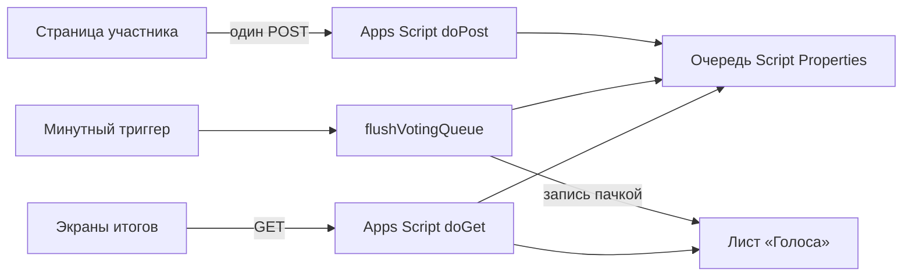

# Голосование: Apps Script и Google Таблица

Техническое описание для разработчиков сайта. Состояние реализации: 18 ноября 2026 года.

## Состав системы

Сайт — статический экспорт Next.js (`output: "export"`). Браузеры напрямую обращаются к опубликованному Google Apps Script; сервер на `cowork.ru` для голосования не используется. Apps Script принимает ответы в общую очередь **Script Properties**, а установленный минутный триггер переносит их в лист **«Голоса»** одной пачкой.

- [Google Таблица](https://docs.google.com/spreadsheets/d/1dy35NRxTSYDKEDIgACOt3cJnRHPx7jtMTkaLzHTIzTs/edit)
- [Опубликованное веб-приложение Apps Script](https://script.google.com/macros/s/AKfycbx3fnef6NNMLLSMIfYSqXP0uCPhD_T49zEFATv6VUzpYh9tq8DSUmz5G_5L_PN3ehFJvg/exec)
- Код Apps Script: [`scripts/voting-sheet/Code.gs`](scripts/voting-sheet/Code.gs)
- Код запросов браузера и URL Apps Script: [`src/lib/voting.ts`](src/lib/voting.ts)
- Вопросы и их ID: [`src/content/voting.ts`](src/content/voting.ts)
- Переменная сборки GitHub Pages: [`.github/workflows/deploy.yml`](.github/workflows/deploy.yml)

## Путь ответа участника

1. QR ведёт прямо на `/vote/question-1/`, `/vote/question-2/`, `/vote/question-3/` или `/vote/question-4/`. При открытии страницы вопроса обращения к Apps Script нет. После загрузки JavaScript сайт проверяет только локальную отметку этого браузера.
2. После выбора «Да» или «Нет» сайт получает или создаёт случайный UUID браузера в `localStorage` (`gigacowork-voting-voter-id-v1`). Отметка ответа записывается под ключом `gigacowork-voting-<VOTING_ROUND_ID>-<questionId>`. Интерфейс сразу показывает «Спасибо, ваш голос учтён».
3. Браузер отправляет один фоновый `POST` на `/exec` с полями формы `voterId`, `questionId`, `answer`. Параметры `mode: "no-cors"` и `keepalive: true` находятся в `queueQuestionVote()`. Клиент не ждёт ответа и не делает повторной отправки. Из-за `no-cors` ответ Apps Script для браузера непрозрачен.
4. `doPost()` проверяет UUID, ID вопроса и значение `yes`/`no`; для принятого ответа создаёт отдельный UUID записи и сохраняет JSON в Script Properties. При успехе скрипт возвращает `{"ok":true,"queued":true}`. Строки в таблице в этот момент ещё может не быть.
5. `flushVotingQueue()` запускается триггером примерно раз в минуту. Она берёт до 500 записей, дописывает их в лист через `setValues()`, вызывает `SpreadsheetApp.flush()` и удаляет перенесённые элементы очереди.

`keepalive` помогает продолжить отправку при закрытии страницы, но не гарантирует доставку. Сообщение об успехе означает принятие ответа **интерфейсом**, а не подтверждение записи Google. Если запрос не дошёл до `doPost()`, браузер всё равно покажет успех; постоянной очереди на устройстве нет. [Описание `keepalive`](https://developer.mozilla.org/en-US/docs/Web/API/Request/keepalive).

## Данные и защита от дублей

Допустимые `questionId`: `question-1`–`question-4`; ответы: `yes` и `no`. Текст утверждений хранится на сайте. `voterId` — случайный UUID браузера, а не идентификатор человека.

| Столбец листа «Голоса» | Содержание |
| --- | --- |
| `Время` | Время приёма голоса скриптом. |
| `ID браузера` | `voterId`. |
| `Вопрос` | `questionId`. |
| `Ответ` | `yes` или `no`. |
| `Ключ голоса` | UUID элемента очереди. |

Пятый столбец защищает от повторной записи **одного элемента очереди**. Если скрипт записал пачку в лист, но остановился до её удаления из Script Properties, следующий запуск обнаружит ключи в листе и не продублирует строки. Это не проверка «один голос на человека»: два отдельных POST с теми же `voterId` и `questionId` будут посчитаны дважды. Ограничение повторного ответа реализовано только в `localStorage` браузера.

## Чтение итогов

`doGet()` поддерживает `action=results&callback=<имя>` и `action=snapshot&voterId=<UUID>&callback=<имя>`. Ответ выдаётся как JSONP (`callback({...});`), что позволяет статическому сайту читать веб-приложение без собственного API. `results` содержит `total`, `questions[questionId].yes/no`, `updatedAt`; `snapshot` добавляет `ownAnswers` для переданного UUID.

При каждом GET скрипт читает лист и ещё ожидающие элементы Script Properties. Он исключает элемент очереди из повторного подсчёта, если его ключ уже присутствует в пятом столбце. Поэтому сценический экран может показать голос до его переноса в таблицу.

| URL | Назначение | Запросы к Apps Script |
| --- | --- | --- |
| `/vote/question-N/` | Голосование участника и благодарность. | 0 при открытии, 1 POST при ответе. |
| `/vote/question-N/results/` | Итог одного вопроса на сцене. | GET при открытии и каждые 5 секунд. |
| `/vote/results/stage/` | Все вопросы на одном экране сцены. | GET при открытии и каждые 5 секунд. |
| `/vote/results/` | Общий отчёт. | GET при открытии и каждые 10 секунд. |
| `/vote/` | Обзор всех вопросов; QR на него не ведёт. | Один GET `snapshot` при открытии. |

Для чтения клиент делает до трёх попыток при ошибке. Экран отчёта показывает ошибку, сохраняя ранее загруженные цифры. Периодические GET отправляет браузер с открытым экраном результатов, а не браузеры голосующих.

## Установка на сайт

1. Открыть указанную Google Таблицу под аккаунтом владельца: **Расширения → Apps Script**. Вставить весь [`Code.gs`](scripts/voting-sheet/Code.gs) и сохранить.
2. В редакторе выполнить `setupVotingSheet()` и предоставить Google запрошенные разрешения. Функция создаст лист или пятый столбец при необходимости, затем один минутный триггер `flushVotingQueue`. Проверить, что журнал показывает завершение без ошибки, а триггер появился в разделе «Триггеры».
3. Развернуть веб-приложение с параметрами **«Выполнять от имени: Я»** и **«Доступ: Все»**, включая посетителей без Google-аккаунта. При изменении кода редактировать существующее развертывание, выбрав новую версию: URL `/exec` сохранится. При создании другого развертывания обновить URL на сайте. [Развертывания](https://developers.google.com/apps-script/concepts/deployments), [права веб-приложения](https://developers.google.com/apps-script/guides/web).
4. При **сборке** сайта задать `NEXT_PUBLIC_VOTING_QUEUE_MODE=true`. Для текущего GitHub Pages флаг уже добавлен в `.github/workflows/deploy.yml`; при сборке для `cowork.ru` другим CI его нужно задать в том CI. Локальная `.env.local` также содержит флаг, но обычно не попадает в Git. После изменения `NEXT_PUBLIC_*` требуется новый билд: значение встраивается в клиентский код.
5. Разместить статический каталог `out/`. При размещении в корне `cowork.ru` переменную `NEXT_PUBLIC_BASE_PATH` не задавать. В GitHub Pages workflow добавляет путь репозитория. QR-ссылки должны открывать прямые URL вопросов со слэшем на конце.

`NEXT_PUBLIC_VOTING_APPS_SCRIPT_URL` при необходимости переопределяет адрес `/exec`. Сейчас адрес уже задан в `src/lib/voting.ts`. Альтернативная переменная `NEXT_PUBLIC_VOTING_API_BASE_URL` относится к другому API; при непустом URL Apps Script текущий клиент использует Apps Script. `NEXT_PUBLIC_*` публичны в браузере — секреты в них помещать нельзя.

## Приёмка и диагностика

1. Открыть прямую страницу вопроса в чистом браузере. До ответа в Network не должно быть запроса к Apps Script.
2. Проголосовать: благодарность появляется сразу, в Network отправляется один POST на `/exec`.
3. Проверить `/vote/results/stage/`: после принятия POST очередным GET должен появиться новый голос.
4. После запуска минутного триггера проверить строку в листе и заполненный пятый столбец. Итог на сцене при переносе не должен увеличиться повторно.
5. Если очередь не переносится, проверить разделы **«Выполнения»** и **«Триггеры»** в Apps Script, разрешения владельца и активность триггера. Если сайт не получает итоги, проверить версию развертывания `/exec`, его доступ, адрес в сборке и ошибки GET.

18 ноября 2026 года проведён последовательный тест четырёх вопросов по 300 голосов с интервалами 10–11 минут. Все 1200 ответов появились в листе и отчёте без пропусков и повторов. Подробности — в [кратком отчёте](VOTING_LOAD_TEST_REPORT_2026-11-18.md). Это проверка данного развертывания, а не гарантия при любой сети и любой одновременной нагрузке.

## Сброс перед конференцией

1. Остановить распространение QR-ссылок и дождаться завершения запросов. При одновременном сбросе и голосовании новые ответы могут появиться после очистки.
2. В Apps Script выполнить `clearVotingQueue()`: она очищает только Script Properties.
3. Удалить тестовые строки из листа «Голоса», сохранив заголовки. После последнего теста в листе было 1200 тестовых строк.
4. Если теми же браузерами будут голосовать заново, изменить `VOTING_ROUND_ID` в `src/lib/voting.ts` и пересобрать сайт. Новый ID меняет ключ локальной отметки; саму таблицу и очередь он не очищает.
5. При изменении вопросов одновременно обновить `src/content/voting.ts` и `VOTING_QUESTION_IDS` в `Code.gs`, затем обновить развертывание Apps Script и сборку сайта.

## Ограничения и эксплуатация

- Публичный `/exec` принимает анонимные запросы. UUID не подтверждает личность и не мешает прямым повторным POST. Права на саму таблицу задаются отдельно; она хранит ID браузеров и ответы.
- Если Google отклонил вызов до выполнения `doPost()`, голос не попадёт в общую очередь. При ошибке `setProperty()` браузер тоже не узнает об отказе. Очередь ускоряет запись в таблицу, но не устраняет ограничения на число одновременно выполняемых вызовов Apps Script.
- Если триггер остановлен или потерял разрешения, голоса остаются в очереди до восстановления. После заполнения Script Properties новые записи перестанут приниматься; за ошибками запусков нужно следить в Apps Script.
- На дату описания Google указывает лимит **500 КБ для одного хранилища Script Properties** и **30 одновременных выполнений на аккаунт**. Последняя величина не означает «30 запросов в секунду». Квоты могут изменяться. [Квоты Apps Script](https://developers.google.com/apps-script/guides/services/quotas), [Script Properties](https://developers.google.com/apps-script/guides/properties), [триггеры](https://developers.google.com/apps-script/guides/triggers/installable).
